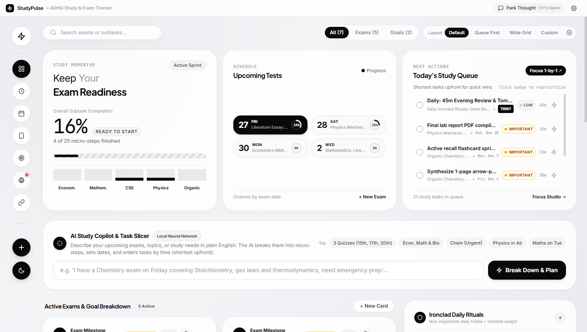
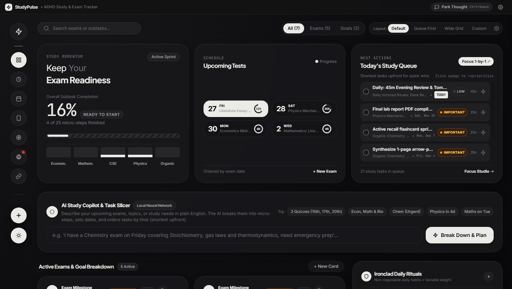
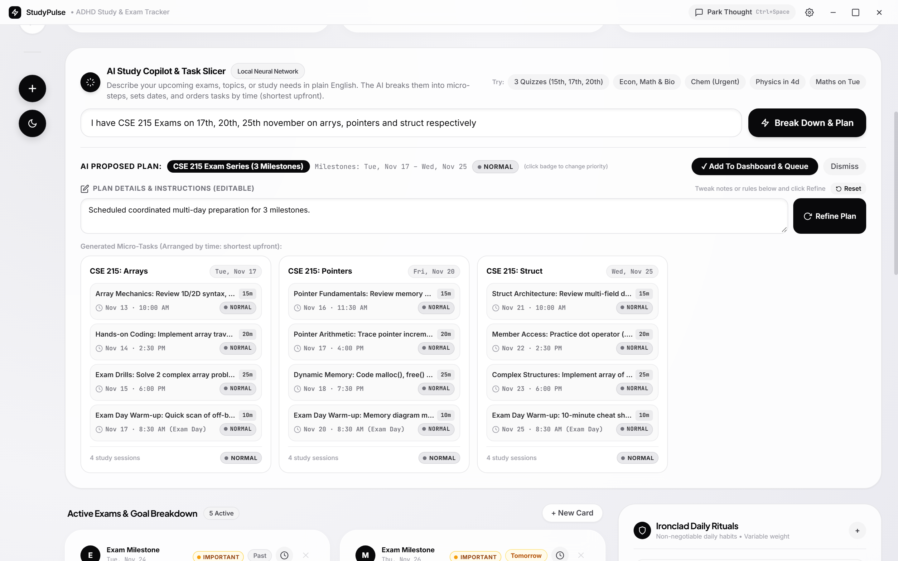
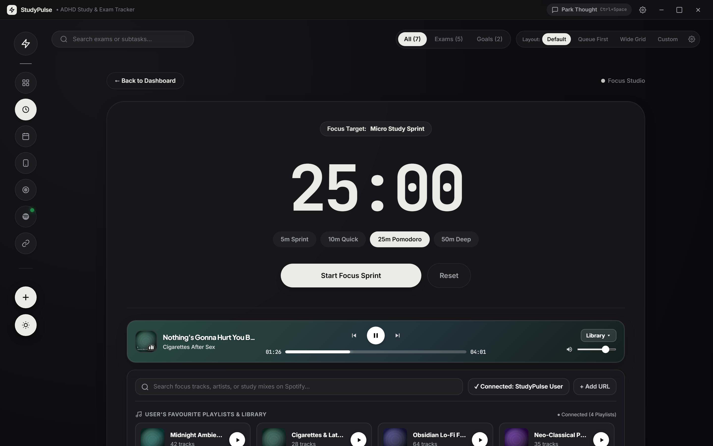
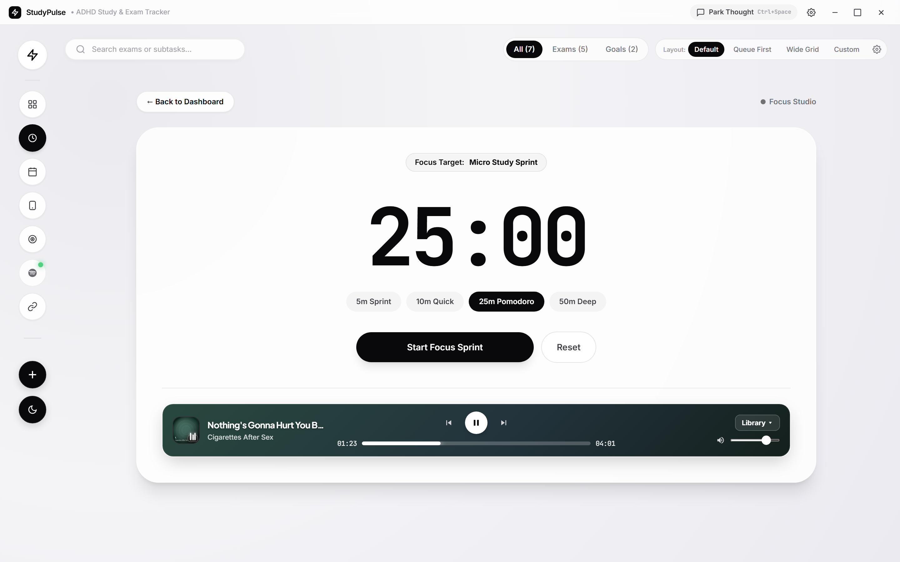
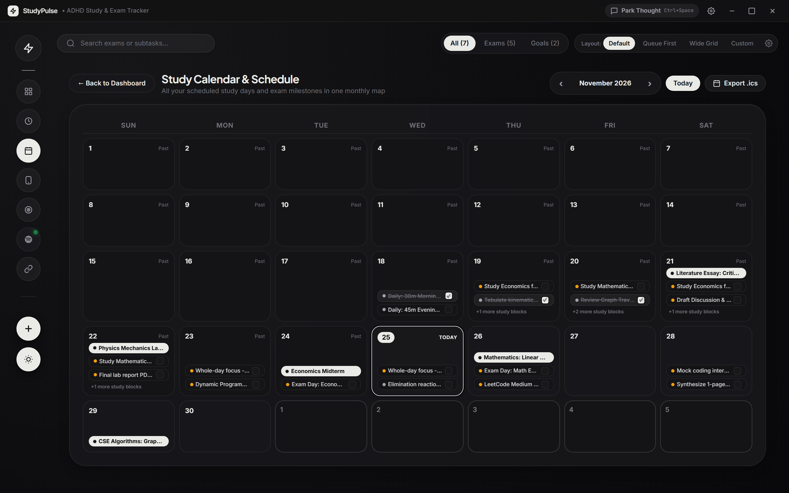
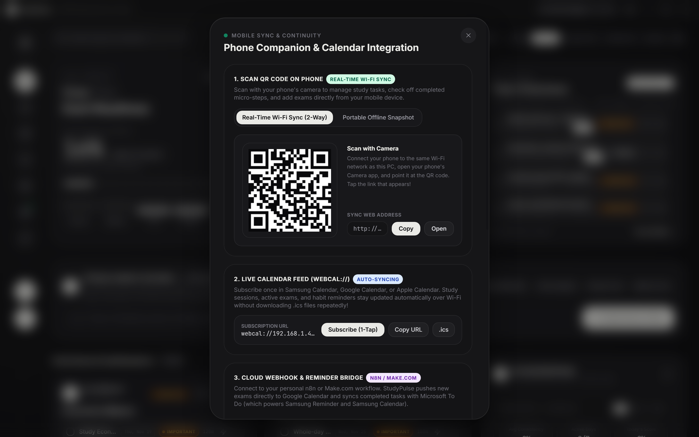

# StudyPulse ⚡
> **Cognitive ADHD Study & Exam Command Center**  
> *Engineered to dissolve executive dysfunction, study initiation paralysis, and cognitive overwhelm.*




---

## 🌟 Overview

**StudyPulse** is an executive-function companion desktop application crafted specifically for students and knowledge workers with ADHD. Built with a sleek, distraction-free aesthetic and studio-grade typography (**Plus Jakarta Sans**, **Inter**, and **JetBrains Mono**), it bridges high-precision task slicing, dynamic Spotify audio integration, and zero-latency desktop workflows.

---

## ✨ Key Features

### 🧠 1. AI Study Copilot & Multi-Exam Task Slicer
- **Multi-Exam Decomposition**: Automatically parses complex, natural language prompts (e.g., *"I have CSE 215 Exams on 17th, 20th, 25th november on arrays, pointers and struct respectively"*) into coordinated, milestone-based cards.
- **Shortest-Upfront Micro-Tasks**: Breaks intimidating study topics into actionable 5-to-25 minute cognitive steps, prioritizing hands-on coding and problem drills to bypass friction.
- **Dual Inference Engine**:
  - **Smart NLP Slicer**: Built-in, ultra-fast Python regex & intent classifier.
  - **Neural LLM Mode**: Zero-idle-RAM ephemeral subprocess executing quantized local GGUF models (`SmolLM2-360M`).



### 🎵 2. Studio-Grade Spotify Integration & Floating Mini-Player
- **Full Console & Ambient Floating Mini-Player**:
  - Supports **Standard Pill** mode and **Compressed Album Art** mode.
  - Real-time Win32 and drag physics with snap-to-edge support.
  - **Dynamic Spatial Color Extraction**: Extracts real-time palette gradients from album covers, dynamically adjusting typography and control contrast for white, cream, or obsidian art styles.
  - Audio transport controls, track seekbar, playlist quick-switcher, and binaural focus audio presets.



### ⏱️ 3. Focus Studio & Anti-Paralysis Mode
- **Dual-State Pomodoro Engine**: 25m focus sprint with audio cues and auto-syncing Spotify states.
- **Single-Task Anti-Paralysis View**: Strips away all dashboard distractions to display only the single next step with micro-starter actions (e.g., *"Step 0: Open tools & set up workspace"*).



### 📅 4. Interactive Exam Roadmap & Calendar
- Day-by-day exam schedules with color-coded priority badges (`IMPORTANT`, `NORMAL`, `LOW`).
- Readiness indicators and streak tracking via the **Ironclad Daily Rituals** console.



### 📱 5. Two-Way Phone Companion & Sync
- Real-time mobile companion sync via local QR code pairing and bidirectional webhooks.
- Live RFC 5545 iCalendar feed export for Apple Calendar, Google Calendar, and Outlook.



---

## 🛠️ Tech Stack & Architecture

- **Backend**: Python 3.14 + `pywebview` + Native Win32 API (`ctypes`, `DWM` window management).
- **Frontend**: Vanilla HTML5, Modern ES6+, TailwindCSS, FontAwesome 6, KaTeX, Canvas 2D colorimetry.
- **Packaging**: PyInstaller standalone single-executable compilation.
- **Typography**: Plus Jakarta Sans, Inter, JetBrains Mono with fallback offline system stacks.

---

## 🚀 Getting Started

### Prerequisites
- Python 3.10+ (tested on Windows 11 / 10 x64)
- Microsoft Edge WebView2 Runtime (installed by default on Windows 10/11)

### Installation & Run

1. **Clone the repository:**
   ```bash
   git clone https://github.com/Sakhawat-Rahman/StudyPulse.git
   cd StudyPulse
   ```

2. **Install dependencies:**
   ```bash
   pip install -r requirements.txt
   ```

3. **Launch StudyPulse:**
   ```bash
   python app.py
   ```

---

## 📦 Building the Standalone Executable

To compile a self-contained, standalone Windows `.exe` with zero external runtime dependencies:

```bash
pyinstaller StudyPulse.spec --noconfirm
```

The resulting executable will be placed in `dist/StudyPulse.exe`.

---

## 📄 Documentation

- [Full Architecture & User Manual (PDF)](docs/StudyPulse_Comprehensive_Manual.pdf)
- [Official Pitch Deck Showcase (PDF)](docs/StudyPulse_Pitch_Deck_Showcase.pdf)
- [Development & Implementation Logs](docs/logs.md)

---

## 📜 License

Distributed under the MIT License. See `LICENSE` for more information.
